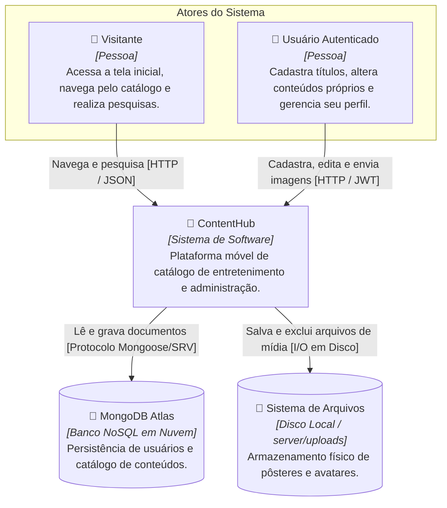
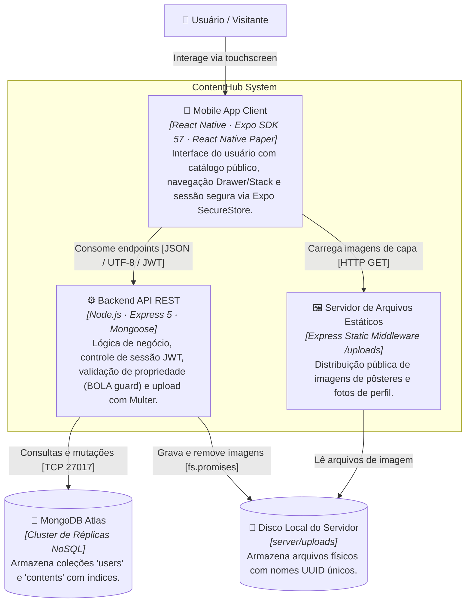
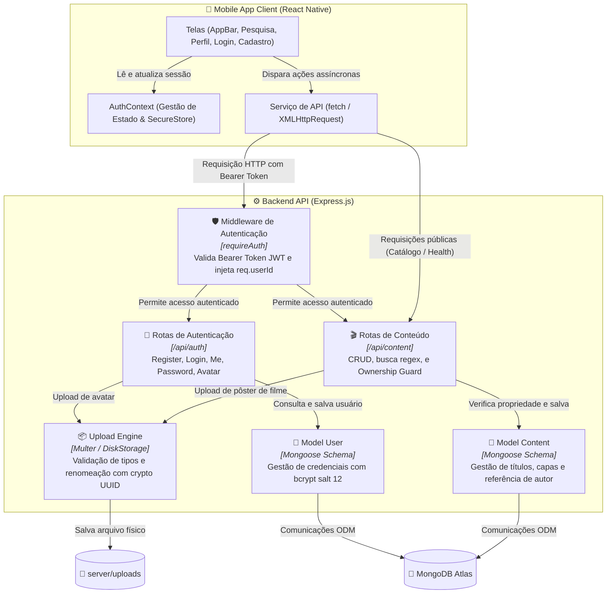
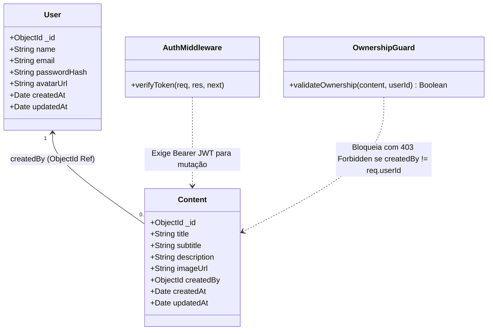

# ContentHub

Aplicativo Expo / React Native com catálogo público de entretenimento, pesquisa em tempo real, autenticação JWT, área administrativa com controle de acesso por proprietário (RBAC/BOLA guard), gerenciamento completo de imagens e API RESTful Express integrada ao MongoDB Atlas.

---

## 🏛️ Arquitetura do Sistema — C4 Model

O sistema foi modelado utilizando a metodologia **C4 Model** (Context, Containers, Components, Code), fornecendo diferentes níveis de abstração técnica para fácil compreensão arquitetural.

### Nível 1: Diagrama de Contexto (System Context)
Apresenta o sistema ContentHub no centro de seu ecossistema, destacando os atores humanos e as integrações externas fundamentais.



---

### Nível 2: Diagrama de Contêineres (Containers)
Evidencia a separação física e lógica entre os ambientes de Frontend (Mobile Client), Backend (API REST) e camadas de persistência.



---

### Nível 3: Diagrama de Componentes (Components)
Detalha a arquitetura interna do contêiner da **API Backend** e seus relacionamentos com o aplicativo cliente.



---

### Nível 4: Diagrama de Código e Entidades (Code / Data Schema)
Modela a estrutura de dados das coleções no MongoDB Atlas e as regras de autorização de recursos.



---

## Organização do Projeto

```text
assets/
  sample-movies/        Pôsteres cinematográficos em alta definição para testes
src/
  components/           Componentes reutilizáveis (Cards, ContentForm, CabecaMenu, SplashScreen)
  context/              Estado global e sessão de autenticação (AuthContext)
  screens/              Telas do aplicativo (AppBar, Pesquisa, Acesso, Login, Cadastro, Perfil)
  services/             Comunicação HTTP cliente com a API (api.js)
  theme/                Design System e paleta de cores (React Native Paper)
server/
  src/
    middleware/         Middleware de proteção JWT (auth.js)
    models/             Modelos Mongoose (User.js, Content.js)
    index.js            Rotas Express, tratamento de erros e inicialização da API
  uploads/              Armazenamento de mídia física (pôsteres e avatares)
  seed.js               Script de população inicial do banco de dados
```

---

## Requisitos do Ambiente

- **Node.js:** versão 20 ou superior
- **Dispositivo Móvel:** Expo Go instalado no smartphone Android (ou emulador Android Studio)
- **Banco de Dados:** Instância MongoDB local ou MongoDB Atlas em nuvem

---

## Como Iniciar o Backend (API Express)

1. No terminal, acesse a pasta do servidor:
   ```powershell
   cd server
   npm install
   Copy-Item .env.example .env
   ```

2. Configure as variáveis de ambiente em `server/.env`:
   ```env
   PORT=3000
   MONGODB_URI=mongodb+srv://<usuario>:<senha>@<cluster>.mongodb.net/technologic?retryWrites=true&w=majority
   JWT_SECRET=sua-chave-secreta-de-pelo-menos-32-caracteres
   ```

3. *(Opcional)* Popule o banco com a conta de teste e 3 filmes com descrições ricas em português:
   ```powershell
   npm run seed
   ```
   > Cria a conta `ranzer@gmail.com` (senha: `123456789`) e cadastra os títulos *Interestelar*, *A Origem* e *O Poderoso Chefão*.

4. Inicie o servidor da API em modo de desenvolvimento:
   ```powershell
   npm run dev
   ```
   > A API ficará disponível em `http://localhost:3000`. Teste o endpoint de saúde em `http://localhost:3000/api/health`.

---

## Como Iniciar o Frontend (Expo / React Native)

1. Em outro terminal, na pasta raiz do projeto:
   ```powershell
   npm install
   Copy-Item .env.example .env
   ```

2. Ajuste o arquivo `.env` da raiz de acordo com o ambiente que utilizará:
   - **No navegador Web:** `EXPO_PUBLIC_API_URL=http://localhost:3000`
   - **No Emulador Android:** `EXPO_PUBLIC_API_URL=http://10.0.2.2:3000`
   - **No Celular Físico via Expo Go:** `EXPO_PUBLIC_API_URL=http://<IP-DO-COMPUTADOR-NA-REDE>:3000` *(ex: `http://192.168.0.15:3000`)*

3. Inicie o Metro Bundler:
   ```powershell
   npx expo start
   ```
   - Pressione **`a`** para abrir no emulador Android.
   - Ou escaneie o QR Code com o aplicativo **Expo Go** no celular.

---

## Endpoints da API

### Autenticação & Usuários
- `POST /api/auth/register`: Cadastro de novo usuário (gera hash com bcrypt salt 12)
- `POST /api/auth/login`: Autenticação e emissão de token JWT (expiração em 7 dias)
- `GET /api/auth/me`: Retorna dados do usuário autenticado *(Exige JWT)*
- `PUT /api/auth/password`: Alteração segura de senha com revalidação da senha atual *(Exige JWT)*
- `POST /api/auth/avatar`: Upload de foto de perfil *(Exige JWT · multipart/form-data)*
- `DELETE /api/auth/avatar`: Remoção da foto de perfil *(Exige JWT)*

### Catálogo de Conteúdos
- `GET /api/content`: Listagem pública de conteúdos (suporta filtro por query `?q=termo`)
- `POST /api/content`: Criação de novo conteúdo vinculado ao autor *(Exige JWT)*
- `PUT /api/content/:id`: Alteração de dados do conteúdo *(Exige JWT · Apenas o criador)*
- `DELETE /api/content/:id`: Exclusão de conteúdo e da imagem correspondente *(Exige JWT · Apenas o criador)*
- `POST /api/content/:id/image`: Upload/substituição de pôster do filme *(Exige JWT · Apenas o criador)*
- `DELETE /api/content/:id/image`: Remoção do pôster do filme *(Exige JWT · Apenas o criador)*
